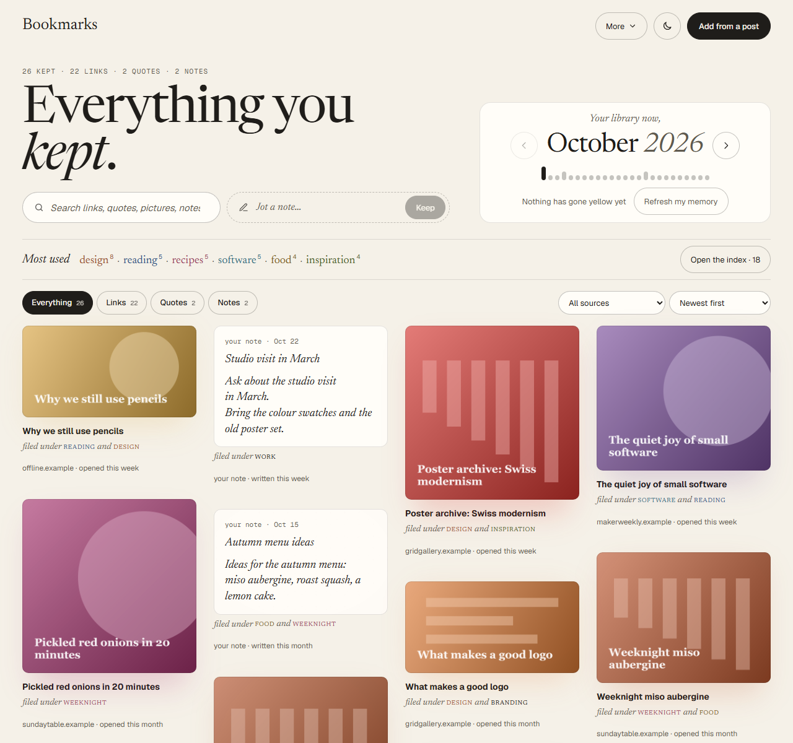
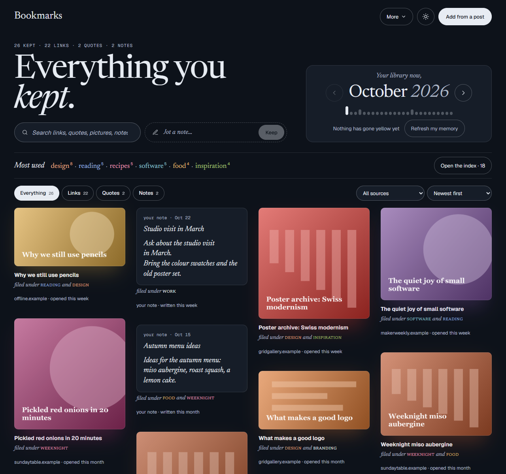
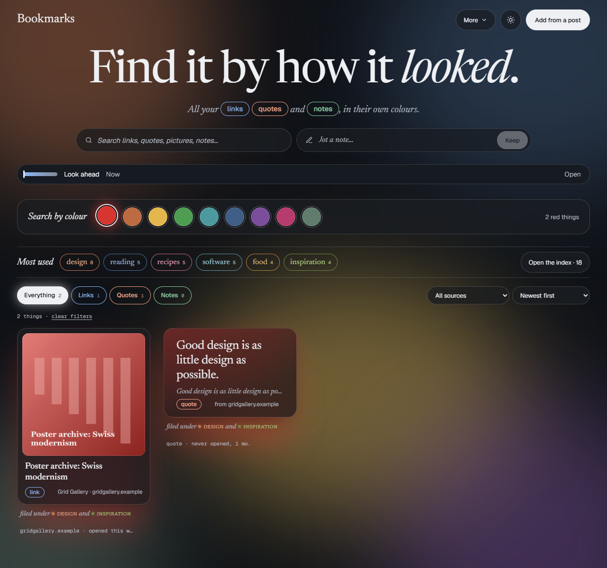
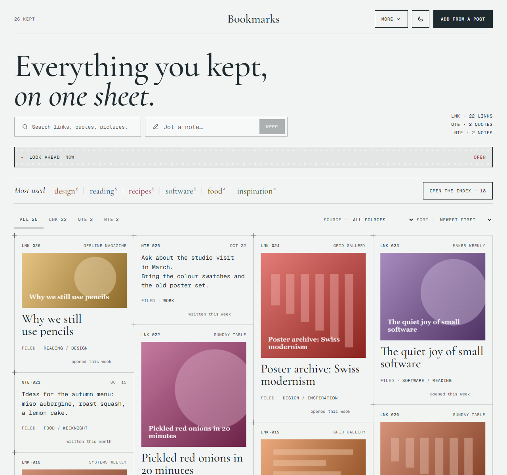
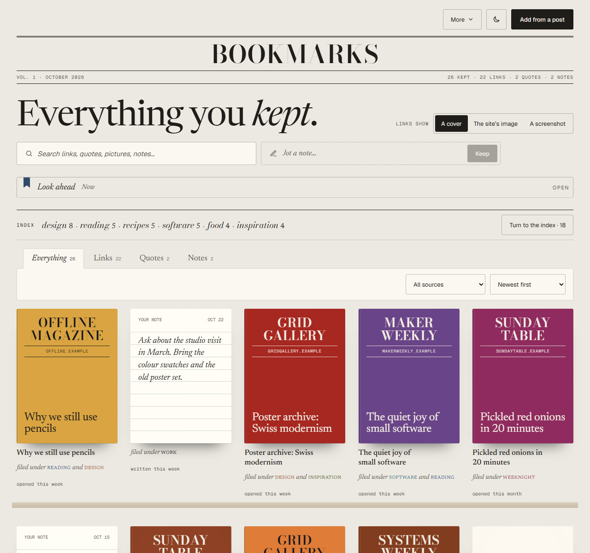
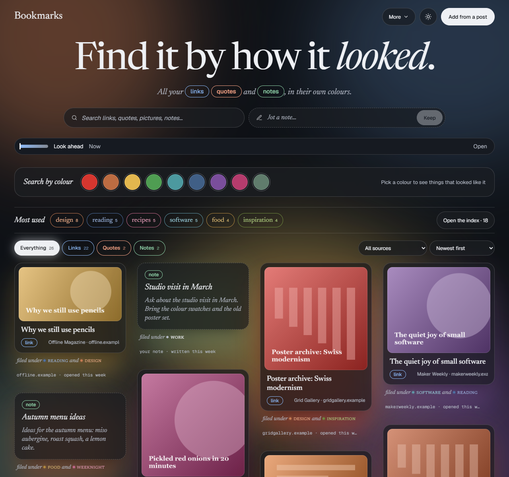

# Bookmark Manager

A visual bookmark manager that makes you want to look at your bookmarks. A browser extension for Chrome, Edge and other Chromium browsers. Everything is stored locally in your browser: no account, no server, no tracking.

## Features

- **Save in one click** (`Alt+Shift+S`), or right-click a link, picture or selected text to keep it without leaving the page.
- **Visual by default.** Every bookmark gets a preview, either a screenshot or the site's own image, so you recognise things by how they looked.
- **Links, quotes, pictures and notes** live together in one library, filterable by kind and searchable by text, including the words of every saved page.
- **Find it by colour.** Pick a colour and see everything that looked like it.
- **Pull every link out of a post.** Paste a post's link or text (X, Bluesky, Mastodon, Reddit, Hacker News, LinkedIn…) and review the links it mentions before saving.
- **Look ahead and ageing.** Bookmarks you haven't opened fade, and *Refresh my memory* brings old ones back.
- **Four themes**, each in light and dark.
- **Import, back up and restore.** Bring in Edge favorites, a Pocket or Raindrop export or any bookmarks file, export JSON backups, and check for dead links in the background.

## Screenshots

| Dark mode | Colour search |
|---|---|
|  |  |

| Contact sheet | Covers | Colour field |
|---|---|---|
|  |  |  |

The sites in these screenshots are invented sample data.

## Load it in Chrome or Edge

1. `npm install` (first time only)
2. `npm run build`. This creates the `dist/` folder.
3. Open `chrome://extensions` (or `edge://extensions`), turn on **Developer mode**, click **Load unpacked** and pick the `dist` folder.
4. Pin the extension to the toolbar (puzzle-piece icon → eye icon).

While working on it, `npm run dev` rebuilds `dist/` on every change. After a rebuild, click the reload arrow on the extension's card in `edge://extensions` and reopen the side panel.

To change the keyboard shortcut, go to `edge://extensions/shortcuts`.

## Load it in Firefox

1. `npm run build:firefox`. This creates the `dist-firefox/` folder (Firefox 140 or later).
2. Open `about:debugging#/runtime/this-firefox`, click **Load Temporary Add-on…** and pick `dist-firefox/manifest.json`. Firefox forgets temporary add-ons when it closes.

The Firefox version is the same extension with three differences: the panel opens in Firefox's sidebar, the background runs as an event page instead of a service worker, and cards show no site icons, because Firefox has no icon cache that extensions can read and asking each site for its icon would tell them what you keep. If pages stop getting previews, check that the add-on still has permission to access websites (`about:addons` → Bookmark Manager → Permissions).

## How it works

| Action | What happens |
|---|---|
| Click the icon, or `Alt+Shift+S` | Saves the current page and opens the side panel to add tags or a note |
| Right-click a link → *Save link to Bookmark Manager* | Saves the link without opening it. A ✓ flashes on the icon (`=` if it was already saved) |
| Right-click a picture → *Save picture to Bookmark Manager* | Keeps a copy of the picture, linked to the page it was on |
| Select text, right-click → *Save quote to Bookmark Manager* | Saves the text as a quote, linked to the page it was on |
| *New note* in the library, or *Write a note* in the side panel | A note of your own, with tags. The first line is its title unless you give one. `Ctrl+Enter` saves |
| *Open library ↗* in the side panel | Opens the full library in a tab |
| *Refresh my memory* in the library | Shows a few old bookmarks you haven't opened in a long time |
| *Import favorites* | Copies Edge favorites in, skipping duplicates. Edge's own favorites aren't changed |
| *Import from Pocket or a file* | Reads a Pocket or Raindrop CSV export, or a bookmarks HTML file from any browser, Raindrop or Pinboard, with its folders, tags and notes. Unzip Pocket's export first |
| *Add from a post* in the library | Paste a post's link or text; the sites it mentions are listed for you to tag and save |
| *Find links in this post* in the side panel | Same, read straight from the post you have open (works for logged-in-only posts) |
| *Back up* / *Restore* | Exports or merges a JSON backup |
| *Check links* in the library | Re-checks every link in the background and flags ones that seem dead |

**Back up regularly:** uninstalling the extension deletes its library.

## Pictures, quotes and notes

- They live in the library with your links. The kind pills above the grid filter by kind, and search covers quote and note text.
- Clicking a picture or quote opens the page it came from; clicking a note opens it for editing.
- Saving the same picture or quote twice doesn't make a copy. Saving a quote or picture from a page doesn't count as saving the page.
- **Backups** keep everything except the picture files themselves. After a restore, pictures are downloaded again from their original address; pictures that only existed inside the page (`blob:` or `data:` addresses) can't be, and show a placeholder.

## Previews and details

- **Saving the page you're on** takes a screenshot and reads the page's details from what you see, including logged-in pages.
- **Imported and right-clicked links** are fetched in the background, a few at a time and no more than one request per site every 1.5 seconds. The library shows progress. Anything unfinished resumes when Edge starts, and the extension retries hourly.
- **Two kinds of preview** are kept: the screenshot and the site's own preview image. Cards show the image for regular sites and the screenshot for social posts, and you can pick the other in *Edit*. Pages with neither get a colored card in the site's brand color.
- **Platform** (Substack, X, YouTube, GitHub…) is detected from the address, and from clues in the page for platforms on custom domains (Substack, Medium, Ghost, WordPress).
- **Saved copies:** the readable text of each page is kept when it's saved (from the live page when you save the tab you're on, otherwise fetched once in the background), up to about 10,000 words. Search looks inside it, and *Edit* shows it, so a link that dies still has its words. The first copy is kept; later checks don't replace it. Backups include it.
- **Dead links:** a link counts as dead if the site says the page doesn't exist (404/410), or if it doesn't answer in two checks at least six hours apart. Sites that block bots aren't flagged, because we can't tell.

## Links from posts

- **Pasting a post's link** reads it from each platform's public data: X (embed service), Bluesky, Mastodon, Reddit and Hacker News (their APIs), and LinkedIn's public post page. Threads, Instagram and Facebook hide posts from anyone not logged in, so for those open the post and use *Find links in this post* in the side panel.
- **Pasting a post's text** finds full links and bare ones like `figma.com/community`. Addresses the post cut short (`figma.com/commu…`) become the site's home page, marked as such and left unticked.
- **Short and redirect links** (t.co, bit.ly, lnkd.in, Instagram's and Threads' "leaving" links…) are followed to the real address, and tracking and affiliate tags (`utm_…`, `?via=`) are removed.
- **Left out:** links back to the same platform (profiles, hashtags), the post's images and videos, and "share this" buttons.
- **Review before saving:** each link shows its title and whether it's new or already saved. New links are ticked; links already in the library only change if you add tags. Each saved link remembers which post it came from (shown in *Edit*, and searchable).
- On a page that isn't a post, *Find links on this page* reads the page's main article, or the whole page if it has none. Nothing is ticked there, since menus and ads get picked up too.

## Project layout

- `src/background.ts`: icon click, shortcut and right-click saving
- `src/sidepanel/`: the side panel
- `src/library/`: the full library tab
- `src/lib/`: data model (`db.ts`), saving and duplicate detection (`bookmarks.ts`, `normalize.ts`), import, backup and resurfacing, links from posts (`posts.ts`, `linkfinder.ts`)
- `src/styles/base.css`: design tokens. All colors, spacing and type sizes live here for the design pass

`npm test` runs the unit tests for duplicate detection, saving, page details and finding links in posts.

## License

[MIT](LICENSE)
